# Agent Pet

[English](README.md) | **Tiếng Việt**

**Một thú cưng nhỏ trên màn hình, đồng hành cùng bạn khi Claude Code và Codex làm việc.**

Tích hợp OpenCode và Antigravity đang ở giai đoạn thử nghiệm, có trong **Cài đặt → Khởi động và agent**. Xem [hướng dẫn và phạm vi hỗ trợ](starter/docs/integrations.md#opencode-and-antigravity-experimental).

Thú cưng luôn ở bên bạn trên màn hình: suy nghĩ cùng agent, bận rộn khi agent chạy công cụ và vẫy tay khi cần bạn phê duyệt. Bạn có thể rời mắt khỏi terminal mà vẫn biết lúc nào cần quay lại.

  
  
  
  

- **Nhìn là biết trạng thái**: dễ dàng theo dõi các phiên agent đang làm gì.
- **Không bỏ lỡ yêu cầu**: thông báo nhỏ xuất hiện khi agent chờ bạn; một cú nhấp đưa bạn đến đúng terminal.
- **Chơi cùng thú cưng**: kéo, vuốt ve, tung lên, ngắm nó đi dạo và ngủ.
- **Nhắc bạn chăm sóc bản thân**: nghỉ mắt, uống nước, ăn trưa, vận động cùng Break Buddy và xem lại hoạt động trong ngày.
- **Riêng tư**: chỉ nhận biết *loại hoạt động*, không đọc prompt, mã nguồn hay câu lệnh của bạn.

Hỗ trợ **Linux** x86_64 (X11 hoặc desktop Wayland có XWayland như GNOME và KDE), **macOS 11+** (Apple silicon và Intel), và **Windows 10 phiên bản 1809 trở lên / Windows 11** (x64).

## Nhập thú cưng hoặc plugin của bạn

Trong **Cài đặt → Thú cưng / Plugin**, chọn **Nhập…** hoặc kéo tệp `.agentpet` vào
thú cưng hay cửa sổ Cài đặt. Đọc và chấp nhận điều khoản, rồi khởi động lại ứng dụng.
Có thể dùng `agent-pet import <file.agentpet>` hoặc
`agent-pet remove <pet|plugin> <id>` mà không cần giao diện. Cài đặt cũng có nút gỡ
gói; nếu kiểm tra gói thay thế thất bại, gói cũ được giữ nguyên. Xem
[hướng dẫn tạo thú cưng](starter/docs/pets.md#importing-and-removing-packs) và
[gói plugin](starter/docs/plugins.md#importing-a-agentpet-file).

## Bắt đầu

Tải phiên bản mới nhất từ [trang Releases](https://github.com/WindyWin/vpet-agent-pet/releases/latest). Chọn hệ điều hành trong bảng **Download / Tải xuống** ở đầu trang phát hành; mỗi gói đều có sẵn hình ảnh thú cưng.

**Linux**

1. Tải `agent-pet-<version>-linux-x86_64.tar.gz` và giải nén.
2. Trong thư mục vừa giải nén, chạy `./install.sh`. Trình cài đặt cho bạn chọn thư mục cài đặt, thêm ứng dụng vào menu, kết nối với Claude Code hoặc Codex và tự khởi động thú cưng khi phiên agent bắt đầu.
3. Khởi động lại Claude Code hoặc Codex và gửi một prompt. Thú cưng sẽ phản ứng.

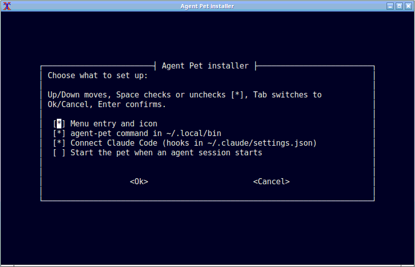

**macOS**

1. Tải và giải nén tệp `.zip` cho macOS, rồi chuyển **Agent Pet** vào **Applications**.
2. Mở ứng dụng. Lần đầu, macOS yêu cầu xác nhận: vào **System Settings → Privacy & Security → Open Anyway** (trên macOS 14 trở xuống, giữ Control rồi nhấp ứng dụng → **Open**).
3. Nhấp chuột phải vào thú cưng → **Cài đặt → Khởi động và agent** (Settings → Startup and agents), chọn **Bật** (Enable) cạnh Claude Code hoặc Codex, rồi khởi động lại ứng dụng agent.

**Windows**

1. Tải và chạy `agent-pet-<version>-windows-x86_64-setup.exe`. Ứng dụng được cài cho người dùng hiện tại, không cần quyền quản trị và xuất hiện trong menu Start với tên **Agent Pet**. Qt, Visual C++ runtime và hình ảnh thú cưng đã được đóng gói sẵn.
2. Trong bộ cài, chọn kết nối Claude Code hoặc Codex và tự khởi động thú cưng khi đăng nhập Windows hoặc khi phiên agent bắt đầu. Bạn cũng có thể kết nối sau tại **Cài đặt → Khởi động và agent** (Settings → Startup and agents).
3. Khởi động lại Claude Code hoặc Codex và gửi một prompt. Hook của Claude Code cần phiên bản **2.1.139 trở lên**; với Codex, xác nhận tin cậy hook trong `/hooks`.

Bản Windows chưa được ký mã. Nếu SmartScreen cảnh báo, chọn **More info → Run anyway**. Các phiên bản mới cung cấp bộ cài Setup; nếu đang dùng bản portable, hãy chạy Setup để chuyển sang bản được cài đặt. Xem [hướng dẫn cài Windows](starter/docs/install.md#windows) để biết chi tiết.

Cần hướng dẫn kỹ hơn hoặc gặp vấn đề? Xem [hướng dẫn cài đặt](starter/docs/install.md) và [bảng xử lý sự cố](starter/docs/install.md#troubleshooting) (tiếng Anh).

## Các tính năng

*Tất cả hình ảnh đều chụp từ ứng dụng thật; tên dự án chỉ là ví dụ.*

### Hiển thị hoạt động của agent

Bạn có thể chạy nhiều phiên cùng lúc. Thú cưng luôn hiển thị phiên cần chú ý nhất: yêu cầu đang chờ bạn được ưu tiên hơn lỗi, lỗi được ưu tiên hơn lượt vừa hoàn thành, v.v.

<table>
  <tr>
    <td align="center"> Đang suy nghĩ</td>
    <td align="center"> Đang đọc tệp</td>
    <td align="center"> Đang làm việc</td>
    <td align="center"> Đang chờ bạn</td>
  </tr>
  <tr>
    <td align="center"> Có thao tác thất bại</td>
    <td align="center"> Xong rồi!</td>
    <td align="center"> Ngủ sau 10 phút yên tĩnh</td>
    <td align="center"> Giật mình trước lệnh nguy hiểm như <code>rm -rf</code></td>
  </tr>
</table>

Khi làm việc, thú cưng cũng thay đổi động tác: đặt sách xuống, cầm bút lên ngay tại bàn, xoay bút và thỉnh thoảng có những phản ứng nhỏ. Trong **Cài đặt**, bạn có thể chọn **Nhẹ nhàng** (Subtle) hoặc **Cổ điển** (Classic, lặp một hoạt ảnh cho mỗi hoạt động); chế độ mặc định là **Tinh nghịch** (Playful).

<table>
  <tr>
    <td align="center"> Từ đọc sang viết</td>
    <td align="center"> Xoay bút</td>
  </tr>
</table>

### Báo khi agent cần bạn

Khi agent cần phê duyệt, cần bạn nhập thông tin hoặc gặp lỗi công cụ, một thông báo ngắn xuất hiện cạnh thú cưng. Chọn **Mở** (Open) để chuyển đến terminal hoặc trình soạn thảo của phiên đó, hoặc **×** để đóng thông báo. Dấu hiệu màu cam vẫn hiển thị trên thú cưng cho đến khi bạn phản hồi. Bạn có thể tắt thông báo hoặc bật âm thanh khi có thông báo mới.

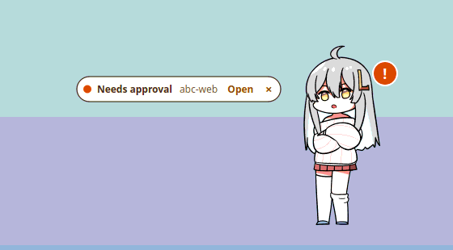

### Tất cả phiên trong một danh sách

Nhấp vào thú cưng để xem các phiên đang chạy, sắp xếp theo mức độ cần chú ý. Nhấp vào một phiên để chuyển đến phiên đó.

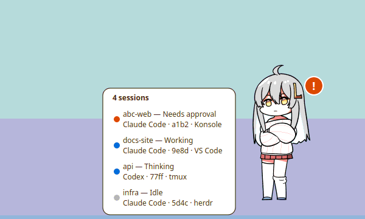

### Chơi cùng thú cưng

Kéo thú cưng đến bất kỳ đâu, nó sẽ đung đưa theo con trỏ. Nhấn giữ chuột trái trên đầu hoặc bụng và giữ yên để vuốt ve. Thả giữa lúc đang đung đưa, nó sẽ ngã xuống rồi đứng dậy. Đẩy ra mép màn hình, nó sẽ trốn ở đó và ló đầu ra cho đến khi agent bận rộn trở lại.

Nhưng đừng quá tay: tung quá nhiều, vuốt ve liên tục hoặc giữ quá lâu sẽ khiến nó giận và bỏ đi.

<table>
  <tr>
    <td align="center"> Kéo và tung</td>
    <td align="center"> Trốn ở mép màn hình</td>
  </tr>
  <tr>
    <td align="center"> Xoa đầu</td>
    <td align="center"> Chạm bụng</td>
  </tr>
  <tr>
    <td align="center" colspan="2">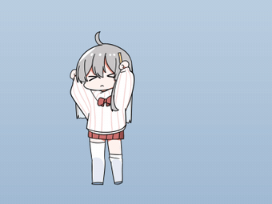 Vuốt ve quá nhiều: giận rồi bỏ đi</td>
  </tr>
</table>

### Có nhịp sống riêng

Khi không có việc cần chú ý, thú cưng ngáp, nhìn quanh, thỉnh thoảng đi dạo, bò trên màn hình hoặc leo mép màn hình. Nó cũng có tâm trạng: nhiều lượt hoàn thành khiến nó vui, nhiều lỗi khiến nó buồn, còn làm việc liên tục quá lâu khiến nó đói — cũng là lời nhắc bạn nên nghỉ một chút.

Khi một lượt hoàn thành, VPet chọn ngẫu nhiên cách ăn mừng: vẫy tay, reo vui lấp lánh, cười ngượng hoặc một trong hai động tác chân mèo vui vẻ. Vẫy tay có xác suất gấp đôi từng phản ứng còn lại; dịp đặc biệt và phần thưởng tích lũy có thể mang đến cách ăn mừng khác.

<table>
  <tr>
    <td align="center"> Đi bộ</td>
    <td align="center"> Bò</td>
    <td align="center"> Leo</td>
  </tr>
  <tr>
    <td align="center"> Động tác khi rảnh</td>
    <td align="center"> Vui vẻ</td>
    <td align="center"> Đến lúc nghỉ rồi?</td>
  </tr>
</table>

### Những bất ngờ nhỏ

Tối thứ Sáu, sinh nhật bạn, đêm khuya, công việc kéo dài và mỗi lượt hoàn thành thứ 100 đều có phản ứng riêng. Ngày thường, thú cưng nhắc bạn chuẩn bị về nhà; ban đêm, nó nhắc bạn đi ngủ. Vẫn còn ít nhất một bất ngờ khác để bạn khám phá.

<table>
  <tr>
    <td align="center"> Điệu nhảy tối thứ Sáu</td>
    <td align="center"> Sinh nhật bạn</td>
    <td align="center"> Ngày 20 tháng 5</td>
    <td align="center"> Mỗi lượt thứ 100</td>
  </tr>
</table>

### Nhắc bạn chăm sóc bản thân

Cứ sau 20 phút làm việc, thú cưng nhắc bạn nhìn ra xa; nhấp vào lời nhắc để có 20 giây yên tĩnh. Mỗi giờ, VPet nâng cốc uống nước để nhắc bạn uống cùng. Đến giờ ăn trưa (mặc định 12:00), nó ăn bánh mì và nhắc bạn nghỉ trưa. Bạn có thể chọn **Xong**, **Để sau** (nhắc lại sau 10 phút) hoặc **Bỏ qua hôm nay**.

Hoàn thành lời nhắc, VPet sẽ chọn ngẫu nhiên một trong **sáu phản ứng vui vẻ**: cười ngượng, reo vui lấp lánh, vẫy tay, nhảy múa, thả tim hoặc ăn mừng cột mốc. Với lời nhắc uống nước, ăn trưa và về nhà, phản ứng xuất hiện khi bạn chọn **Xong**; với nghỉ mắt và nghỉ vận động, VPet ăn mừng khi đếm ngược kết thúc. Sau đó, VPet trở về trạng thái nghỉ; một phản ứng có thể xuất hiện hai lần liên tiếp.

**Break Buddy** mời bạn dành 60 giây để vận động sau mỗi giờ làm việc. Chọn **Bắt đầu nghỉ** để VPet nhảy dây cùng bạn trong lúc bạn vận động hoặc giãn cơ. Bạn cũng có thể bắt đầu bất cứ lúc nào từ menu chuột phải → **Nghỉ vận động**, hoặc nhấp vào lời nhắc để kết thúc sớm. Vào **Cài đặt → Lời nhắc → Nghỉ vận động** để tắt lời nhắc hoặc chọn khoảng cách giữa các lần nhắc: **30**, **60** hoặc **90 phút**.

Thú cưng chỉ nhắc khi bạn đang dùng máy tính, giữ yên lặng khi agent cần bạn và không làm phiền vào ban đêm. Khoảng nghỉ vận động sẽ kết thúc nếu có yêu cầu phê duyệt hoặc lỗi cần bạn xử lý, hoặc khi bạn khóa màn hình, tạm hoãn hay tắt thông báo, ẩn thú cưng hoặc nhấc nó lên. Các thú cưng khác có hoạt ảnh riêng khi nhắc bạn.

<table>
  <tr>
    <td align="center"> Break Buddy</td>
    <td align="center"> Cùng ăn trưa</td>
    <td align="center"> Cùng uống nước</td>
  </tr>
</table>

<table>
  <tr>
    <td align="center">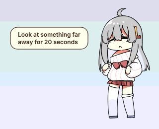 Nghỉ mắt</td>
    <td align="center"> Đến giờ uống nước</td>
  </tr>
</table>

### Tổng kết ngày làm việc

Nhấp chuột phải → **Tổng kết hôm nay** (Today's recap) để xem tóm tắt một dòng, ví dụ *“Hôm nay: 38 lượt trên 3 dự án · lượt dài nhất: 22 phút”*. Nhấp vào bản tóm tắt để xem chi tiết từng dự án. Lời nhắc về nhà vào các ngày trong tuần cũng kèm tổng kết này.

<table>
  <tr>
    <td align="center">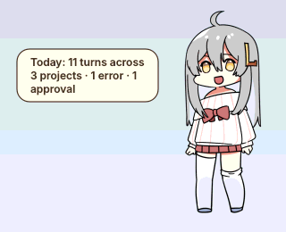 Tóm tắt</td>
    <td align="center">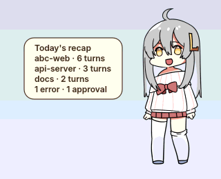 Chi tiết</td>
  </tr>
</table>

### Tùy chỉnh theo ý bạn

Nhấp chuột phải vào thú cưng (hoặc biểu tượng ở khay hệ thống / thanh menu) để xem danh sách phiên và tổng kết ngày, bắt đầu nghỉ vận động, tắt thông báo, giữ thú cưng luôn ở trên cùng, mở **Cài đặt** (Settings) hoặc **Thoát** (Quit). Trong **Cài đặt**, bạn có thể:

- đổi kích thước, chọn những thông báo được hiển thị và chọn nhân vật (thú cưng khác được tải về khi chọn);
- chọn mức độ sinh động khi rảnh và khi làm việc, hoặc tắt đi dạo, tâm trạng, tương tác và bất ngờ;
- bật [gói plugin](starter/docs/plugins.md) để thêm hoạt ảnh cho thú cưng, và để chúng phản ứng khi script hoặc CI của bạn gửi [một sự kiện tùy chỉnh](starter/docs/events.md#custom-events);
- chỉnh hoặc tắt lời nhắc nghỉ mắt, uống nước và nghỉ vận động; đặt giờ nhắc ăn trưa (mặc định 12:00, có thể nhắc đến 13:15), nhắc thứ Hai, về nhà và đi ngủ; nhập ngày sinh nhật;
- kết nối Claude Code và Codex bằng một cú nhấp, tự khởi động cùng agent hoặc khi đăng nhập;
- chọn cách cài đặt bản cập nhật.

Giao diện hỗ trợ **tiếng Anh và tiếng Việt**. Mặc định, ứng dụng dùng ngôn ngữ hệ thống; vào **Cài đặt → Chung → Ngôn ngữ** (Settings → General → Language) để đổi ngôn ngữ ngay.

Nếu thú cưng che mất nội dung, nhấp biểu tượng ở khay hệ thống để ẩn nó. Nó vẫn theo dõi các phiên và hiển thị dấu hiệu cần chú ý trên biểu tượng.

<table>
  <tr>
    <td align="center" valign="top">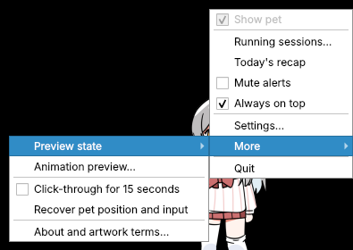 Menu chuột phải</td>
    <td align="center" valign="top">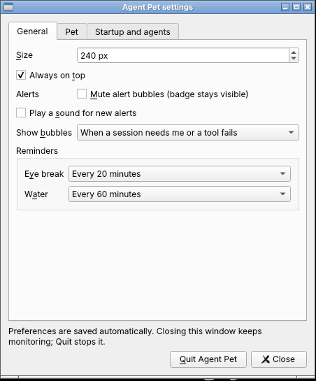 Cài đặt</td>
  </tr>
</table>

### Cập nhật phiên bản

Trên Linux, mặc định thú cưng tự cập nhật trong nền, chỉ tải những phần đã thay đổi và giữ nguyên cài đặt. Nếu bản mới không khởi động được, ứng dụng quay lại bản trước.

Trên Windows, phiên bản được cài bằng bộ cài hỗ trợ tự động cập nhật tại **Cài đặt → Cập nhật** (Settings → Updates). Ứng dụng tải bộ cài đã được xác minh bằng SHA-256, lưu các phiên đang theo dõi, nâng cấp ngay trong thư mục cài đặt rồi khởi động lại thú cưng. Cài đặt, hook và tùy chọn khởi động được giữ nguyên. Windows chưa hỗ trợ tự động quay lại phiên bản trước; nếu cập nhật thất bại, hãy chạy bộ cài thủ công để sửa chữa. Các bản Windows cũ cần nâng cấp thủ công một lần để có trình cập nhật mới.

Trên macOS và bản Windows portable, thú cưng thông báo khi có phiên bản mới để bạn cài thủ công: thay ứng dụng trên macOS hoặc chạy bộ cài Windows mới hơn. Xem [hướng dẫn cập nhật](starter/docs/install.md#update-notifications-and-automatic-updates) để biết các chế độ cập nhật và cách khôi phục.

## Quyền riêng tư

- Mọi dữ liệu hoạt động đều nằm trên máy bạn. Thú cưng chỉ nhận sự kiện từ agent qua một kênh cục bộ riêng.
- Nó chỉ biết *loại hoạt động* (suy nghĩ, làm việc, chờ, hoàn thành), không nhận prompt, mã nguồn, nội dung tệp hay câu lệnh. Với lệnh nguy hiểm, nó chỉ nhận một giá trị có/không cho biết “lệnh này có vẻ nguy hiểm”.
- Dữ liệu lưu lại chỉ gồm cài đặt và số liệu tổng kết mỗi ngày (có tên thư mục dự án), giữ trong hai tuần.
- Khi kết nối, ứng dụng thêm các mục hook riêng vào cài đặt Claude Code hoặc Codex và giữ nguyên các mục khác. Gỡ cài đặt chỉ xóa những mục của Agent Pet.

## Lưu ý khi sử dụng

- **Thú cưng không phản ứng?** Khởi động lại Claude Code hoặc Codex sau khi kết nối, rồi gửi prompt mới. Trong Codex, phê duyệt hook mới tại `/hooks`.
- **Không thấy thú cưng?** Nhấp biểu tượng ở khay hệ thống, hoặc nhấp chuột phải → **Thêm → Khôi phục vị trí và điều khiển thú cưng** (More → Recover pet position and input).
- **macOS:** chưa hỗ trợ đưa cửa sổ terminal lên trước và tự động cài cập nhật. **Mở** (Open) vẫn chuyển được khung terminal trong tmux và herdr.
- **Dùng Herdr?** Plugin [herdr-agent-pet](https://github.com/WindyWin/herdr-agent-pet) khởi động thú cưng cùng máy chủ Herdr và cài đặt hoặc cập nhật ngay trong Herdr: `herdr plugin install WindyWin/herdr-agent-pet`. Plugin hỗ trợ Linux x86_64 và macOS, yêu cầu Herdr 0.7.5 trở lên. Xem [hướng dẫn plugin Herdr](starter/docs/install.md#herdr-plugin): cách khởi động này không hỗ trợ điều hướng **Open** của Herdr.
- **Windows:** **Mở** (Open) đưa cửa sổ Windows Terminal hoặc console cổ điển của agent lên trước; nếu không tìm được, ứng dụng tìm trình soạn thảo hoặc terminal theo cây tiến trình cha. Phiên bản được cài bằng bộ cài hỗ trợ tự động cập nhật; bản portable cần nâng cấp thủ công. Dùng `agent-pet-cli.exe` cho lệnh hook và thao tác cần xuất kết quả ra console.
- **Linux trên Wayland:** thú cưng chạy qua XWayland, có sẵn mặc định trên GNOME và KDE. Chưa hỗ trợ Wayland thuần.

## Dành cho lập trình viên

### Tổng quan kiến trúc

Kiến trúc mục tiêu từ đầu vào đến hiển thị. **Các ô nét đứt là phần dự kiến**; những phần còn lại đã có. Mũi tên thể hiện luồng chạy, không phải thứ tự biên dịch.

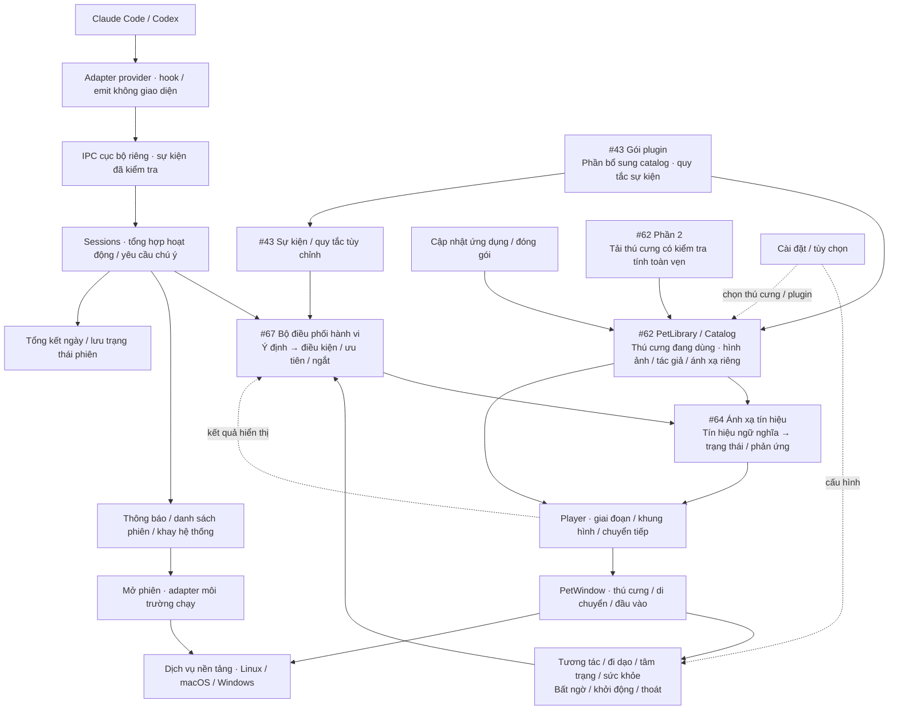

`Sessions` xác định thứ tự ưu tiên giữa các phiên; #67 chọn ý định hành vi; #64 quyết định cách thú cưng thể hiện tín hiệu đã chọn. Thông báo được xử lý theo luồng riêng. Việc di chuyển và thao tác với cửa sổ hệ điều hành vẫn do `PetWindow` và các dịch vụ nền tảng đảm nhiệm. Xem [bản đồ mã nguồn](starter/docs/architecture.md#code-map) để tìm các tệp liên quan và các quyết định thiết kế.

### Lộ trình theo kiến trúc

Các công việc còn mở, đã đối chiếu với mã nguồn đã hợp nhất ngày 2026-10-08 (#62, #64, #67 và giai đoạn 1–3 của #43 đã hoàn thành; chưa kiểm tra lại trạng thái issue trên GitHub). Mỗi issue chứa danh sách tiêu chí nghiệm thu chi tiết; đánh dấu dòng tương ứng khi giai đoạn hoàn thành và cập nhật sơ đồ khi một lớp dự kiến đã được triển khai.

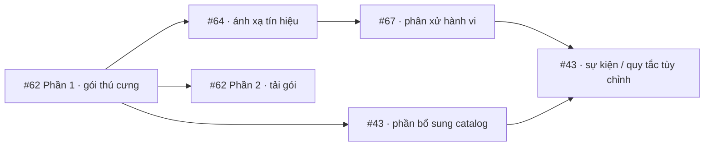

| Hoàn thành | Phần kiến trúc | Công việc / issue | Phụ thuộc |
| --- | --- | --- | --- |
| ☑ | PetLibrary / Catalog | [#62 Phần 1 — chọn gói thú cưng](https://github.com/WindyWin/vpet-agent-pet/issues/62) | Nền tảng độc lập |
| ☑ | Ánh xạ tín hiệu | [#64 — tín hiệu ngữ nghĩa và ánh xạ riêng cho từng thú cưng](https://github.com/WindyWin/vpet-agent-pet/issues/64) | #62 Phần 1 |
| ☑ | Bộ điều phối hành vi | [#67 — phân xử ý định và vòng đời](https://github.com/WindyWin/vpet-agent-pet/issues/67) | #64 |
| ☑ | Catalog plugin | [#43 Giai đoạn 1 — phần bổ sung catalog và cài đặt plugin](https://github.com/WindyWin/vpet-agent-pet/issues/43) | #62 Phần 1 |
| ☑ | Sự kiện plugin | [#43 Giai đoạn 2 — sự kiện tùy chỉnh và quy tắc sự kiện của plugin](https://github.com/WindyWin/vpet-agent-pet/issues/43) | Phần bổ sung catalog, #64 và #67 |
| ☑ | Điều kiện kích hoạt có sẵn → quy tắc | [#43 Giai đoạn 3 — chuyển các điều kiện kích hoạt viết cứng sang bảng quy tắc](https://github.com/WindyWin/vpet-agent-pet/issues/43) | Sự kiện plugin |
| ☑ | Phân phối thú cưng | [#62 Phần 2 — tải theo yêu cầu có kiểm tra tính toàn vẹn](https://github.com/WindyWin/vpet-agent-pet/issues/62) | #62 Phần 1 |
| ☐ | Adapter provider | [#36 — client agent thứ ba](https://github.com/WindyWin/vpet-agent-pet/issues/36) | Hợp đồng sự kiện hiện có |
| ☐ | Thông báo / cài đặt | [#34 — tạm hoãn / chế độ tập trung](https://github.com/WindyWin/vpet-agent-pet/issues/34) | Luồng thông báo hiện có |
| ☐ | Thông báo / yêu cầu chú ý | [#35 — tăng mức nhắc phê duyệt](https://github.com/WindyWin/vpet-agent-pet/issues/35) | Theo dõi yêu cầu chú ý hiện có |
| ☐ | Tâm trạng / tương tác | [#37 — kiếm phần thưởng để cho thú cưng ăn](https://github.com/WindyWin/vpet-agent-pet/issues/37) | Bộ đếm tâm trạng hiện có; phối hợp phản ứng với #67 |

### Biên dịch và đóng góp

Mã ứng dụng nằm trong [`starter/`](starter/README.md): hướng dẫn biên dịch từ mã nguồn, chạy kiểm thử, tùy chọn dòng lệnh, gửi sự kiện demo và đóng gói. Tài liệu đọc thêm (tiếng Anh):

- [Tổng quan kiến trúc](starter/docs/architecture.md) và [các quyết định thiết kế](starter/docs/adr/README.md)
- [Giao thức sự kiện](starter/docs/events.md) và [tích hợp Claude Code / Codex](starter/docs/integrations.md)
- [Quy tắc commit cho CI](starter/README.md#ci-commit-rules): dùng `docs: ...` hoặc `docs(scope): ...` khi toàn bộ thay đổi chỉ là tài liệu. Commit cuối được push lên `main` có tiền tố `docs` sẽ bỏ qua các job build/test/package; GitHub vẫn có thể hiển thị workflow với các job bị bỏ qua. Tag phiên bản và chạy workflow thủ công vẫn build.

Thư mục gốc còn giữ bộ hình ảnh VPet nguyên bản (khoảng 5.500 khung hình, 735 MiB), để bổ sung hoạt ảnh. Ứng dụng không cần bộ này để chạy. Kiểm tra bằng `python3 scripts/assets.py verify`, hoặc liệt kê các chuỗi bằng `python3 scripts/assets.py catalog`.

## Ghi nhận tác giả và giấy phép

Hình ảnh nhân vật do **đội ngũ VUP-Simulator** thực hiện, từ [LorisYounger/VPet](https://github.com/LorisYounger/VPet). Hình ảnh tuân theo [điều khoản riêng](licenses/VPET-ARTWORK-TERMS.md); xem [thông báo về bên thứ ba](THIRD_PARTY_NOTICES.md).

Mã nguồn riêng của Agent Pet được cấp phép theo [Apache-2.0](starter/LICENSE). Giấy phép đó không áp dụng cho hình ảnh nhân vật.

## Cài thú cưng từ thư mục cục bộ

Trong Cài đặt → Thú cưng, chọn **Mở thư mục thú cưng**, rồi chép một bộ thú cưng
đầy đủ vào `packs/pets/<id>/`. Khởi động lại để làm mới danh sách thú cưng,
rồi mở Cài đặt, chọn ô **Cục bộ** và khởi động lại;
`--pet <id>` cũng dùng được với thú cưng cục bộ. Siêu dữ liệu hiển thị không hợp lệ
sẽ có lý do và không thể được chọn; toàn bộ hình ảnh được kiểm tra khi khởi chạy
thú cưng. Nếu bộ đã chọn bị xóa hoặc không còn hợp lệ, ứng dụng dùng
VPet cho lần chạy đó và giữ lựa chọn đã lưu. Mục Giới thiệu cho phép đọc điều khoản
hình ảnh của từng thú cưng đã cài. Cập nhật ứng dụng và dọn bộ nhớ tải xuống không
xóa các thư mục này. Xem [hướng dẫn cài đặt](starter/docs/pets.md#installing-a-local-pet)
để biết cấu trúc và giới hạn. Nhập tệp ZIP và duyệt nguồn sẽ được bổ sung ở các giai đoạn sau.

Ứng dụng chỉ tích hợp VPet. Tải gói `.agentpet` từ [thư viện thú cưng](https://github.com/WindyWin/agent-pet-gallery/releases), rồi nhập gói trong Cài đặt → Thú cưng.

Danh mục gói: [duyệt, cài đặt và xuất bản nguồn](starter/docs/pack-sources.vi.md).
