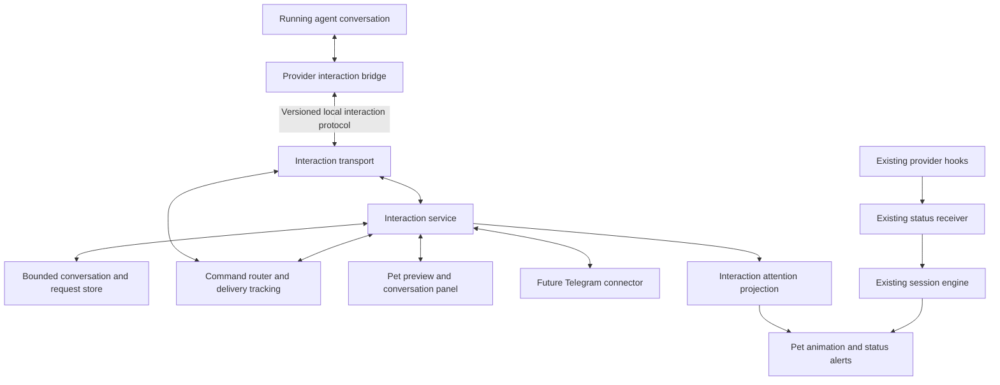

# Direct agent interactions and collapsible conversation panel

Status: proposed implementation specification. Date: 2026-10-19. Stages 1 (provider proof), 2 (core, transport, fake bridge) and 3 (desktop preview, panel and list) are implemented, and the OpenCode bridge half of stage 4 exists; see [the protocol notes](../../starter/docs/interactions.md). The feature is off unless enabled by the `agent_conversations` preference or `--interactions`; there is no Settings control or bridge launcher yet.

This specifies the next interaction feature; it does not describe shipped functionality. Product direction: answer agent option requests and send chat follow-ups directly from the pet, with a shared foundation for future Telegram remote control. Provider API compatibility must be demonstrated during implementation before advertising support.

## Outcome and scope

The user can read an agent message, expand its context, answer a structured question, and send a follow-up to the same running conversation. Closing or collapsing the panel preserves pending questions. The pet continues showing activity across sessions.

First release includes one verified agent integration, completed agent messages, structured single-choice questions, custom answers where allowed, free-text follow-ups, delivery status, and bounded conversation history for the current app lifetime. Each action routes to an explicit session. Unsupported integrations retain their existing status alerts and Open terminal/editor action.

Telegram is a later interface to the same service. Remote permission approvals, agent process launching, arbitrary shell commands, attachments, complete historical transcript import, token streaming, and persistent chat history are outside the first release. A question requesting user input is distinct from a tool permission approval; approval alerts retain their existing host workflow until a separate approval contract is implemented.

## Current implementation and integration points

The app is a C++17 / Qt 6 Widgets executable. The GUI owns the event receiver and session state. Provider hooks send sanitized status events through a private local channel; they do not send prompts, responses, or tool payloads. Existing hook callbacks are short-lived and must remain nonblocking with respect to user interaction.

Relevant references:

- [Architecture and module map](../../starter/docs/architecture.md).
- [Status protocol, ordering and alerts](../../starter/docs/events.md).
- [Provider setup and existing coverage](../../starter/docs/integrations.md).
- [AlertBubble and NoteBubble](../../starter/src/desktop/alert_bubble.h).
- [Session list](../../starter/src/desktop/session_list.h).

The existing `AlertBubble` is deliberately nonfocusable and brings the host forward. Keep a nonfocusable preview and create a separate focusable conversation panel for typing. The pet's own `NoteBubble` reminders remain separate from agent messages.

## Architecture



| Component | Responsibility |
| --- | --- |
| Provider bridge | Attach to an actual conversation using a supported agent interface; publish messages/questions; submit replies; report definitive results and capabilities. |
| Transport | Framing, local endpoint ownership, connection lifecycle, size limits, protocol negotiation, and backpressure. |
| Interaction service | Own conversation identity, request lifecycle, subscriptions, reconciliation, and shared policy for every UI. |
| Command router | Validate session and request revision, arbitrate competing answers, track command IDs, and dispatch through the bound bridge. |
| Store | Retain bounded messages, pending requests, drafts, and command outcomes; provide UI snapshots. |
| Desktop UI | Render preview/history/options, preserve drafts, and submit typed commands. No provider-specific submission logic. |
| Telegram connector | Later translate authorized Telegram messages/buttons into the same commands and render service updates. |

Proposed code boundaries: provider-neutral models/service/router under `starter/src/interactions/`; provider implementations under `starter/src/providers/`; transport contracts and OS implementations under `starter/src/platform/`; preview/panel widgets under `starter/src/desktop/`. Keep the core usable with Qt Core and testable without a display. Names are implementation proposals, not existing modules.

Initially the service lives inside the desktop process. Quitting the app disconnects interaction control; hiding the pet does not. A later headless host may own the same service for Telegram access while the desktop is closed. Only one service instance may own an endpoint; desktop and headless ownership cannot overlap.

### Separate status and interaction channels

Preserve the existing v1 status schema and its content-free behavior. Introduce an independently versioned, bidirectional stream transport for interactions, using private local sockets on POSIX and a user-restricted equivalent on Windows. Do not send content through `emit`, add it to the status datagram, or keep a status hook waiting for an answer.

Use length-prefixed UTF-8 JSON frames, a maximum frame size of 64 KiB, schema validation, and bounded queues. Endpoint names and native implementations must follow the existing platform abstractions. A bridge handshake supplies its provider identity, opaque connection generation, available conversations, and capabilities. A command targets a conversation registered by that connection; arbitrary endpoint paths and executable commands are never accepted from messages.

Interactive integration setup explicitly enables message sharing and reply access. Existing monitoring setup alone does not enable content transfer.

## Provider capability gate

Do not infer reply support from status-hook support. Before selecting the first provider, demonstrate:

1. Obtaining stable conversation, message, and question identifiers.
2. Receiving a structured question and its actual allowed answers.
3. Answering that question in the same running conversation.
4. Sending a follow-up into that conversation after a completed turn.
5. Receiving an authoritative acceptance/rejection result.
6. Detecting disconnects and reconciling pending requests on reconnect.

Record provider version, integration mode, setup steps, and tested capabilities. If direct access requires a managed agent session, state that restriction in setup; do not imply that all externally launched sessions become controllable. No terminal keystroke injection or transcript scraping is assumed by this design.

Advertise capabilities separately: `messages`, `single_choice`, `custom_answer`, `follow_up`, `reconcile`, and `idempotent_commands`. Unsupported actions are disabled with a short explanation and an Open terminal/editor action. Multi-select questions and streaming can be added through explicit capability negotiation later.

## Identity and data contract

Conversation identity is `(provider, session_id, conversation_epoch)`. The epoch changes when a conversation identity is reused for a new conversation; reconnecting to the same conversation preserves it. Connection generation is separate and changes on reconnect. Bind status metadata to this conversation when possible without treating a status expiry as proof that the conversation ended.

| Record | Required information |
| --- | --- |
| Message | Conversation key, stable `message_id`, ordered `sequence`, role, text, creation time. |
| Input request | Conversation key, stable `request_id`, `revision`, question text, option IDs/labels, custom-answer allowance, state; optional authoritative expiry. |
| Command | `command_id`, conversation key, action, payload, source interface; request ID/revision for answers. |
| Command result | Command ID, accepted/rejected/unknown outcome, normalized reason, optional provider receipt. |
| Snapshot | Conversation key, sequence watermark, capabilities, current requests, known command outcomes, available bounded messages. |

Question labels are presentation text; answers use stable option IDs. IDs and sequence numbers come from the bridge's authoritative mapping, not a guess based on display text. A bridge must maintain that mapping for its connection and reconcile it on reconnect. Timestamps are display metadata; sequence and revision determine ordering.

Illustrative answer command:

```json
{
  "version": 1,
  "type": "command",
  "command_id": "cmd-unique-123",
  "conversation": {
    "provider": "example",
    "session_id": "session-42",
    "conversation_epoch": "epoch-1"
  },
  "action": "answer_request",
  "request_id": "question-7",
  "request_revision": 1,
  "payload": { "option_id": "add_tests" },
  "source": "desktop"
}
```

`answer_request` carries exactly one option ID or one custom text answer. `send_follow_up` carries text without a request ID. The expanded UI makes these modes explicit. Reject an answer to an expired, replaced, already answered, or mismatched request. For v1, follow-ups are enabled when the bridge reports the conversation ready for a new turn; there is no implicit queuing or interruption while busy or awaiting an answer.

### Delivery, races and lifecycle

Request states: `pending → submitting → answered`; authoritative cancellation, expiry, or replacement can terminate a pending request. A definitive rejected submission returns it to pending only if the provider still considers it answerable. A delivery timeout becomes `unknown` and requires reconciliation.

User-facing command states:

| State | Display and behavior |
| --- | --- |
| Local draft | Editable; never automatically transmitted. |
| Submitting | “Sending…”; disable repeat submission. |
| Provider accepted | “Sent”; request becomes answered. This does not mean the resulting work succeeded. |
| Definitively rejected | Show reason; retain text; allow correction/retry if still valid. |
| Outcome unknown | “Delivery not confirmed”; retain command ID and reconcile before offering resend. |

Acceptance requires the provider bridge to confirm acceptance by the agent, not just socket delivery. When two interfaces answer concurrently, atomically reserve the request for the first valid command. Reject the other as already submitting or answered. Repeating a command ID returns its known outcome; changing the payload under the same ID is rejected.

Never blindly retry an unknown command. End-to-end exactly-once execution cannot be promised when the provider lacks deduplication or outcome lookup. Across reconnects, reconcile using snapshots and sequence watermarks; show a history gap if replay is unavailable. Reconcile provider-side answers as well, so a question answered in the terminal closes in every interface.

On disconnect, mark the conversation disconnected, preserve drafts and visible history, and disable submission. An ended session leaves readable history until eviction but cannot receive replies. On app restart, memory-only history and drafts are gone; fetch fresh pending state before enabling actions. Never replay old outbound commands automatically.

## Bubble and panel design

### Collapsed preview

Use the current warm cream surface, brown text, rounded outline, and pet-adjacent placement. The preview is a compact two-line card, approximately 300–360 logical pixels wide, with 12 px padding and an 8 px gap from the pet. Text scales with the system font; height grows rather than clipping at larger accessibility sizes.

```text
┌─────────────────────────────────────────┐
│ ● Needs your answer · api-web       +2   │
│ Add tests before continuing?     [View] │
└─────────────────────────────────────────┘
                 🐾
```

Use “New message” for ordinary updates and “Needs your answer” for input requests. The preview is the first nonempty line of the actual message, elided to available width, not an invented summary. The tooltip and accessible description include provider and short session ID. `+N` counts other sessions with pending questions or unread messages and opens the conversation list.

Click the body or View to expand that conversation. Keep a separate Open terminal/editor action inside the panel. A new message never steals keyboard focus or automatically expands the panel. A Hide action in the preview context menu suppresses that preview; it does not answer a question or mark content read.

Pending questions remain eligible for display until resolved; hiding leaves the attention badge. Ordinary previews fade after 8 seconds, pausing on hover; unread state remains available through the session list. Repeated delivery of the same message does not restart the timer or sound.

### Expanded conversation panel

```text
┌──────────────────────────────────────────────┐
│ api-web · Agent · a12f           [Open] [−]   │
│ Connected · Waiting for your answer          │
├──────────────────────────────────────────────┤
│ Agent                                        │
│ I updated the handler.                       │
│ [Show more]                                  │
│                                              │
│ Needs your answer                            │
│ Add tests before continuing?                 │
│ ( ) Add focused tests                        │
│ ( ) Continue without tests                   │
│ ( ) Custom answer                            │
│                                              │
│ Answer this question                         │
│ ┌──────────────────────────────────────────┐ │
│ │ Type a custom answer…                    │ │
│ └──────────────────────────────────────────┘ │
│                           [Send answer]      │
└──────────────────────────────────────────────┘
```

The header always identifies project, provider, and short session ID. Duplicate project names include a parent-path hint; full path and IDs are available in a tooltip. Connection state and delivery feedback use plain labels.

Default size: 400 × 480 logical pixels, resizable within the current screen's available geometry, targeting a maximum of 560 × 640. On smaller displays, clamp to available space with a scrollable body. Use 12–16 px interior spacing, 12 px corner radius, and at least 32 px interactive control height. Inherit the system font and support translated labels.

The body shows chronological agent/user messages. Long ordinary messages initially show roughly six lines with Show more / Show less controls; expansion is per message. Keep the entire current question and options accessible in a scrollable request card, without hiding essential choices behind a text preview. Render plain text and preserved code whitespace in v1; content must not become executable HTML or embedded remote resources.

Selecting an option does not send it. The user selects then presses Send answer. If custom answers are allowed, choosing Custom answer enables the text box; otherwise it is absent. For a free-text question, show just the answer field. Once answered, keep a compact answered card in history.

With no pending question and a ready conversation, the composer reads “Follow up with this agent…” and the button reads Send. If multiple questions exist, show the count and a request selector; each submission answers only the visible, explicitly selected request. Preserve drafts per conversation and request; never transfer one session's draft to another.

### Behavior and accessibility

- The preview remains nonfocusable. The expanded panel is a normal focusable Qt tool window and activates only after an explicit user action.
- Enter adds a newline; Ctrl+Enter sends, with Cmd+Enter on macOS. Tab navigates controls; option selection supports keyboard navigation. IME composition never triggers sending.
- Escape and the header collapse button minimize the panel and preserve drafts. Clicking outside does not discard or automatically collapse it.
- Mark messages read only when they become visible in the expanded viewport. Reading a question does not clear its pending state.
- Announce new request and delivery states through accessible text. Color is supplementary: amber for pending, blue for unread, red for failure, neutral for answered. Verify text/control contrast during UI implementation.
- Keep one expanded panel. Switching sessions is explicit; new activity cannot replace the conversation while the user is typing. New arrivals update the session badge/list.
- Prefer placement right, left, above, then below the pet, clamped to screen work area. Reuse placement policy while considering reminders and other overlays. Suspend pet wandering while the panel is open; deliberate pet dragging reanchors it within the screen.
- Keep session-row activation's existing host-focus behavior; add a distinct Conversation action and unread/pending indicators for capable sessions. The tray/menu also exposes Conversations for keyboard access and click-through recovery.
- Existing mute controls suppress sound. Notification preferences govern new message previews; pending questions follow request visibility rules. A focused agent host may suppress a new preview, but never removes the underlying request.

### Coexistence with existing alerts

Use one presentation coordinator for the agent preview and existing status toast so they do not compete for the same space. Approval/error alerts retain their existing semantics. Input questions share the attention tier; ordinary unread messages are lower priority. A higher-priority alert can replace a collapsed preview, but cannot replace an open conversation.

Deduplicate a status attention event and an interaction request using an explicit provider correlation when available. Where only session correlation exists, show one session attention indicator without assuming two requests are identical. The pet badge counts sessions needing attention, not the sum of status events and questions. Generic tool completion does not resolve an interaction request; its authoritative request state does. Dismissing an alert does not resolve a question.

## Bounds, privacy and failure behavior

Initial implementation limits: 64 interaction conversations, 200 messages per conversation, 16 pending requests per conversation, 16 KiB text per message/answer, 20 options per request, 256 characters per option label, 100 tracked commands per conversation, and a 16 MiB aggregate content budget. Validate UTF-8 byte limits and frame limits before allocation. These are separate from existing status-engine limits.

Evict oldest read messages and inactive conversations first. Never silently evict an active request, in-flight command, or draft. When protected records exhaust capacity, reject new records with a capacity response and expose “Some messages could not be loaded”; keep existing controls usable and offer Open terminal/editor. A provider must not truncate question text/options into a question with different meaning. Oversized questions receive an explicit unsupported-content result.

Keep content and drafts in memory for v1. Do not add them to diagnostic logs, status events, analytics, or crash breadcrumbs. Local transport inherits the current same-user trust boundary with private endpoint permissions; it is not a sandbox against other processes of the same user. Disconnect or malformed input must not block animation, the UI thread, or status monitoring.

Default previews show a short message excerpt. Add a “Hide message previews” preference that displays only identity and request/update state. Remote content delivery is independently opt-in when Telegram is implemented.

## Future Telegram path

### Optional by design

Remote control is an optional add-on, never part of the core and never required. Out of the box the app opens no network connection for interactions, runs no connector, holds no remote credentials, and sends no message content off the machine. Declining Telegram has no effect on local answers, follow-ups, previews or the panel.

Telegram is not a plugin pack. Packs are data-only, load at startup and never run code ([plugins](../../starter/docs/plugins.md)); a connector needs a live authenticated session. It is a separate connector program, or a module of a headless host, that is a client of the interaction service. Settings has a single **Remote control** section, off by default. Enabling a connector is an explicit action that names what it receives, which is message text and question options when previews are on, and what it may do, which is answer questions and send follow-ups. Disabling it disconnects it immediately and revokes its pairing. Each connector is enabled, scoped and revoked on its own.

### Connector extension point

A connector connects to the same private stream as a provider bridge but declares a different role in its handshake: `hello` with `"role": "connector"` instead of a provider identity. A connector never registers conversations, and the service never accepts a bridge frame from one. It can only:

- subscribe to conversation snapshots and changes, within the scope the user granted, and
- send `answer_request` and `send_follow_up` commands, which pass the same validation, arbitration and idempotency as the desktop's. Its commands carry `source` set by the service from the authenticated role, not by the connector.

This role is not implemented yet. The in-process `Service::subscribe` and `Service::submit` are its internal model; the wire role adds the handshake, a per-connector grant (read scope, command scope, per-conversation filter) and a revocation path. Until it exists, the stream accepts bridges only. Third parties can then ship a connector for another chat service as a small separate program without touching the app. Because the transport is the same-user trust boundary, a connector holds no more authority than any other process of the user, so the grant is a consent and least-privilege control, not a sandbox.

### Requirements before Telegram ships

A Telegram connector will call `answer_request` and `send_follow_up` through the same service. It must not implement a second request store or bypass validation. Bind Telegram messages/buttons to opaque service-side conversation/request references; names alone never determine routing. An answer accepted from either interface updates both, including disabling stale buttons.

Before Telegram ships, specify and test authorized user/chat allowlists, credential storage, webhook request verification, update deduplication, rate limits, and pairing/revocation. Callback payloads are references, not trusted action authority. Tool permission approvals remain unavailable unless separately designed and enabled.

A cloud webhook cannot directly reach a private desktop socket. Choose an explicit deployment topology in that phase: a reachable HTTPS connector, or a relay with an outbound authenticated connection from the local service. The local service remains the command authority. Define offline delivery/expiry and headless hosting before promising control while the pet app is closed. No Telegram infrastructure or inbound public endpoint is required for the first release.

## Delivery plan

1. **Provider proof:** demonstrate all first-provider capabilities with a real running session and document limits. This is the implementation gate; do it before committing to UI integration assumptions.
2. **Core and transport:** add models, request state machine, command arbitration, private stream transport, fake bridge, capability negotiation, and reconnect snapshots.
3. **Desktop interaction:** implement preview/panel, options, drafts, message folding, delivery feedback, session navigation, and existing-alert coordination.
4. **First provider release:** wire the verified bridge, expose opt-in setup/coverage, and complete live acceptance on supported OS/provider versions.
5. **Connector role and Telegram (optional):** add the connector handshake, grants and revocation to the stream, a Remote control settings section (off by default), then decide hosting and implement the Telegram connector on that role.

## Acceptance criteria

- A real supported agent asks a structured question; an answer sent from the pet reaches the same conversation and lets it continue.
- A follow-up after a completed turn starts the next turn in that conversation; no new unrelated session is created.
- Collapsed previews, individual long-message expansion, and panel collapse/reopen preserve the expected content and drafts.
- Two simultaneous sessions with identical project names cannot receive each other's answers or drafts.
- A stale option, changed request revision, duplicate command, or second-interface answer cannot submit a second answer to an already resolved request.
- Timeout after dispatch shows unknown delivery, not success or a blind retry; reconnect reconciles the outcome when the provider supports it.
- Answering from the original agent interface closes the pet's pending request after reconciliation.
- Disconnect, app restart, session end, oversized content, and capacity exhaustion have the specified visible behavior and never send drafts automatically.
- A fake second client exercises the future Telegram race and synchronization cases without requiring Telegram infrastructure.
- Existing content-free status hooks, activity animations, host focus, reminder bubbles, mute behavior, and unsupported-provider alerts continue working.
- Keyboard-only operation, IME input, scaled fonts, translated text, multi-monitor edges, small screens, and focus behavior pass manual UI checks.

Use deterministic service/state-machine tests, transport integration tests, and focused widget tests for routing and draft preservation. Record live provider evidence separately from fake-bridge tests. UI acceptance should include screenshots of collapsed, expanded, answered, disconnected, and unknown-delivery states. Production implementation and validation remain future work.
